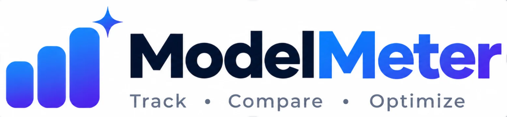
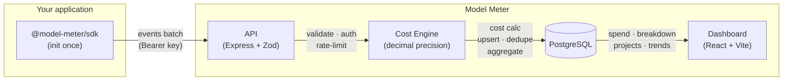

<div align="center">




### Open-source AI spend visibility for engineering teams

Stop discovering your AI bill at the end of the month.<br/>
Model Meter shows you which project, feature, or model is spending — before the invoice arrives.

[](LICENSE)
[](https://www.typescriptlang.org/)
[](https://nodejs.org/)
[](CONTRIBUTING.md)
[](#-roadmap)

**[Join the Waitlist](#-join-the-waitlist)** · [Roadmap](#-roadmap) · [Docs](#-documentation) · [Contributing](#-contributing)

</div>

---

> **Status:** Model Meter is in active development. Core infrastructure is built and working — we're shipping the auth, workspace UI, and hosted experience next. **Join the waitlist to be first in line.**

---

## The Problem

Engineering teams building with LLMs share the same pain:

- **Costs are invisible** until the invoice arrives at the end of the month
- **No attribution** — you can't tell which feature, team, or model drove the spike
- **Provider dashboards** don't break down by your projects or environments
- **Finance asks questions** you can't answer without hours of manual log analysis

The average team discovers a costly AI bug **3–4 weeks after it ships**.

---

## What Model Meter Does

**One place to see all your AI spend — attributed, explainable, and under control.**

|                           |                                                                                 |
| ------------------------- | ------------------------------------------------------------------------------- |
| **Track every request**   | Every LLM call, across every provider, captured automatically via OpenTelemetry |
| **Attribute to projects** | Know exactly which feature, service, or team is spending what                   |
| **Catch spikes early**    | Spend trends updated in near real-time — not end-of-month                       |
| **Compare models**        | See cost vs. quality side-by-side before switching in production                |
| **Reconcile invoices**    | Match your request-level estimates against actual provider bills                |
| **Self-host free**        | Your data stays in your infrastructure. No per-seat or per-event fees.          |

---

## Join the Waitlist

Model Meter is launching soon. Early access members get:

- **First access** to the hosted dashboard (no self-hosting required)
- **Direct input** on the roadmap — tell us what matters most to your team
- **Early adopter pricing** when paid plans launch

**[→ Join the waitlist](https://github.com/jayanti-prajapati/model-meter/issues/new?title=Waitlist%3A+Early+Access+Request&body=**Name%3A**%0A%0A**Team+size%3A**%0A%0A**LLM+providers+you+use%3A**%0A%0A**Biggest+AI+cost+pain+today%3A**%0A%0A**How+did+you+find+Model+Meter%3A**)** — takes 60 seconds, open an issue with your details.

Or just **[⭐ star the repo](https://github.com/jayanti-prajapati/model-meter)** — it helps us gauge interest and keeps you updated as we ship.

---

## Who Is It For?

| Role                    | Pain today                                                 | How Model Meter helps                                        |
| ----------------------- | ---------------------------------------------------------- | ------------------------------------------------------------ |
| **Engineering manager** | "Which feature caused this month's AI cost spike?"         | Per-project cost breakdown, spend trends, anomaly visibility |
| **Backend engineer**    | "I have no idea how much my AI calls cost"                 | Two-line SDK integration, zero impact on existing calls      |
| **Finance / FinOps**    | "The OpenAI invoice doesn't match anything in our systems" | Estimated vs. provider-reported cost side-by-side            |
| **AI/ML engineer**      | "Should I switch from GPT-4o to something cheaper?"        | Cost-per-request and quality comparison across models        |
| **Startup founder**     | "We need visibility but can't afford another SaaS tool"    | 100% self-hostable, Apache 2.0, free forever                 |

**Best fit:** B2B SaaS and AI-native teams with 5–50 engineers using multiple LLM providers.

---

## What's Built

The core is working. Here's where things stand:

| Component                                                                 | Status          |
| ------------------------------------------------------------------------- | --------------- |
| TypeScript SDK (`@model-meter/sdk`) — `init()` once, all AI calls tracked | ✅ Built        |
| Auto-tracking via OpenTelemetry `gen_ai.*` spans — zero code changes      | ✅ Built        |
| Batch ingestion API with per-event validation and idempotency             | ✅ Built        |
| Decimal-precision cost engine with effective-dated pricing                | ✅ Built        |
| React dashboard — spend trends, provider/model/project breakdown          | ✅ Built        |
| Self-hosted via Docker Compose — Postgres auto-migrates on start          | ✅ Built        |
| Multi-workspace data model with tenant isolation                          | ✅ Built        |
| Auth, workspace UI, key management — sign up and log in                   | 🔨 Building now |
| Hosted cloud option (no self-hosting required)                            | 🔨 Building now |
| Gateway adapters (LiteLLM, Portkey, etc.)                                 | 🔜 Next         |
| Workspace budgets and threshold alerts                                    | 🔜 Coming       |
| Provider billing import and reconciliation                                | 🔜 Coming       |
| Cost-to-quality model evaluation                                          | 🔜 Coming       |

---

## Roadmap

| Milestone                       | What ships                                           | Status         |
| ------------------------------- | ---------------------------------------------------- | -------------- |
| **M0 — Foundation**             | SDK, API, cost engine, admin dashboard, Docker       | ✅ Shipped     |
| **M1 — Auth & Workspace UI**    | Sign up, log in, key management, workspace roles     | 🔨 In progress |
| **M2 — Gateway Adapters**       | LiteLLM, Portkey, idempotency, ingestion health      | 🔜 Next        |
| **M3 — Dashboard Polish**       | Effective-dated pricing, full aggregates, alerts     | 🔜 Planned     |
| **M4 — Budgets & Alerts**       | Spend limits, threshold notifications, team invites  | 🔜 Planned     |
| **M5 — Billing Reconciliation** | Provider invoice import, estimated vs. actual report | 🔜 Planned     |
| **M6 — Cost-to-Quality**        | Model evaluation, cost-per-task comparison           | 🔜 Planned     |

See [docs/ROADMAP.md](docs/ROADMAP.md) for full acceptance criteria.

---

## How It Works



**The key design decisions:**

- **Not a proxy** — SDK instruments calls via OTel, your requests go directly to the provider
- **Privacy by default** — prompts and completions are never collected
- **Idempotent ingestion** — retries can't inflate usage or cost
- **Effective-dated pricing** — price changes don't rewrite historical records
- **Tenant isolation** — PostgreSQL RLS enforces workspace boundaries at the DB layer

---

## Try It Today (Self-Host)

The self-hosted version works now. Auth UI is manual for the moment — full signup flow ships in M1.

```bash
git clone https://github.com/jayanti-prajapati/model-meter
cd model-meter
cp .env.example .env          # set INGESTION_KEY_SECRET
docker compose -f docker/docker-compose.yml up -d
```

Admin dashboard → http://localhost:5173 · API health → http://localhost:3000/health

See [docs/GETTING-STARTED.md](docs/GETTING-STARTED.md) for the full setup guide including SDK integration and seeding your first ingestion key.

---

## Tech Stack

| Layer         | Technology                                              |
| ------------- | ------------------------------------------------------- |
| **SDK**       | TypeScript, OpenTelemetry API, Vercel AI SDK (peer)     |
| **API**       | Node.js 22, Express 4, Zod, Knex                        |
| **Database**  | PostgreSQL 16, Knex migrations (auto-run on startup)    |
| **Dashboard** | React 18, Vite 6, shadcn/ui, TanStack Query 5, Recharts |
| **Monorepo**  | Yarn 4 Berry workspaces, Turborepo 2                    |
| **Testing**   | Vitest 3                                                |
| **CI**        | GitHub Actions                                          |
| **Self-host** | Docker Compose, multi-stage Dockerfiles                 |

---

## Who is Model Meter for? (Not for)

**Not designed for:**

- Tracking personal ChatGPT subscription usage
- Teams that need enterprise SSO or SOC 2 from day one
- Replacing a full-featured LLM observability platform (LangSmith, Langfuse)
- Universal LLM proxy with caching

If any of those is your primary need, see [docs/COMPARISON.md](docs/COMPARISON.md) for alternatives.

---

## Contributing

Model Meter is open-source and actively welcomes contributors. The best starting points:

- **[Good first issues](https://github.com/jayanti-prajapati/model-meter/issues?q=is%3Aissue+is%3Aopen+label%3A%22good+first+issue%22)** — curated approachable tasks
- **Provider pricing fixtures** — add or verify pricing records for missing models
- **Gateway adapters** — connect LiteLLM, Portkey, or other gateways
- **Dashboard improvements** — React / shadcn/ui contributions to `apps/admin`
- **Documentation** — provider-specific notes, integration examples

See [CONTRIBUTING.md](CONTRIBUTING.md) for dev setup, PR checklist, and conventions.

---

## Alternatives

| Tool                                     | Relationship                                              |
| ---------------------------------------- | --------------------------------------------------------- |
| [Helicone](https://helicone.ai)          | Proxy-based. Model Meter is non-proxy, stores no prompts. |
| [LangSmith](https://smith.langchain.com) | Prompt debugging + evals. Complementary — use both.       |
| [Langfuse](https://langfuse.com)         | LLM tracing + evals. Open-source, different focus.        |
| [OpenMeter](https://openmeter.io)        | General API metering. Model Meter is AI-cost-specific.    |

Full comparison: [docs/COMPARISON.md](docs/COMPARISON.md)

---

## Documentation

|                                            |                                                   |
| ------------------------------------------ | ------------------------------------------------- |
| [Getting Started](docs/GETTING-STARTED.md) | Docker quickstart, SDK setup, first event         |
| [FAQ](docs/FAQ.md)                         | Pricing, privacy, providers, architecture         |
| [Use Cases](docs/USE-CASES.md)             | Cost attribution, budget alerts, model comparison |
| [Integrations](docs/INTEGRATIONS.md)       | Provider compatibility, gateway adapters          |
| [Comparison](docs/COMPARISON.md)           | vs Helicone, LangSmith, Langfuse, OpenMeter       |
| [Glossary](docs/GLOSSARY.md)               | Term definitions                                  |
| [Architecture](docs/ARCHITECTURE.md)       | Component design, data flow                       |
| [API design](docs/API.md)                  | Endpoints, auth, request/response                 |
| [Security](docs/SECURITY.md)               | Tenant isolation, key management                  |
| [Roadmap](docs/ROADMAP.md)                 | Milestones and acceptance criteria                |
| [Changelog](CHANGELOG.md)                  | Release history                                   |

---

## License

Apache 2.0 — free to use, modify, and distribute. See [LICENSE](LICENSE).

---

<div align="center">

**Model Meter is being built in public.**<br/>
Watch the repo, join the waitlist, or jump in and contribute.

**[⭐ Star to follow along](https://github.com/jayanti-prajapati/model-meter)** · **[📋 Join the waitlist](https://github.com/jayanti-prajapati/model-meter/issues/new?title=Waitlist%3A+Early+Access+Request&body=**Name%3A**%0A%0A**Team+size%3A**%0A%0A**LLM+providers+you+use%3A**%0A%0A**Biggest+AI+cost+pain+today%3A**)** · **[💬 Start a discussion](https://github.com/jayanti-prajapati/model-meter/discussions)**

</div>
