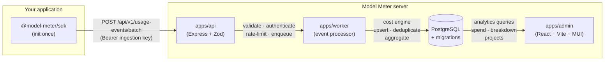

<div align="center">

# ⚡ Model Meter

### Open-source AI spend visibility for engineering teams

Track every LLM token, attribute costs to projects and features, and stop surprise AI bills — with a two-line SDK integration.

[](https://github.com/jayanti-prajapati/model-meter/actions/workflows/ci.yml)
[](LICENSE)
[](https://www.typescriptlang.org/)
[](https://nodejs.org/)
[](https://yarnpkg.com/)
[](CONTRIBUTING.md)

[Quick Start](#-quick-start-60-seconds) · [SDK Install](#-track-ai-spend-in-your-app) · [Architecture](#-architecture) · [Roadmap](#-roadmap) · [Contributing](#-contributing)

</div>

---

## What is Model Meter?

Engineering teams using multiple LLM providers face the same problem: costs are invisible until the invoice arrives, usage can't be attributed to a specific feature or team, and provider-reported bills don't match request-level estimates.

**Model Meter gives you one place to see all of it.** Install the TypeScript SDK in your application, self-host the admin panel, and within minutes you'll have per-request cost attribution, spend trends, and a dashboard your finance team can actually read.

---

## Features

| Feature                                                                       | Status         |
| ----------------------------------------------------------------------------- | -------------- |
| TypeScript SDK (`@model-meter/sdk`) — one `init()` call, all AI calls tracked | ✅ Available   |
| Auto-tracking via OpenTelemetry `gen_ai.*` spans — zero code changes          | ✅ Available   |
| Batch ingestion API with per-event validation and idempotency                 | ✅ Available   |
| Decimal-precision cost engine with effective-dated pricing                    | ✅ Available   |
| React dashboard — spend trends, provider/model/project breakdown              | ✅ Available   |
| Self-hosted via Docker Compose — Postgres auto-migrates on start              | ✅ Available   |
| Multi-workspace data model with tenant isolation                              | ✅ Available   |
| Gateway event adapters (LiteLLM, Portkey, etc.)                               | 🔜 Milestone 2 |
| Workspace budgets and threshold alerts                                        | 🔜 Milestone 4 |
| Provider billing import and reconciliation                                    | 🔜 Milestone 5 |
| Cost-to-quality evaluation across candidate models                            | 🔜 Milestone 6 |

---

## Quick Start — 60 seconds

**Prerequisites:** Docker, Docker Compose.

```bash
git clone https://github.com/jayanti-prajapati/model-meter
cd model-meter

cp .env.example .env
# Open .env and set INGESTION_KEY_SECRET to any random 32-char string:
#   openssl rand -hex 32

docker compose -f docker/docker-compose.yml up -d
```

| Service          | URL                          |
| ---------------- | ---------------------------- |
| Admin dashboard  | http://localhost:5173        |
| API health check | http://localhost:3000/health |

The API runs database migrations automatically on first start. No separate migration step needed.

**Stop the stack:**

```bash
docker compose -f docker/docker-compose.yml down
```

---

## Track AI Spend in Your App

### 1. Install

```bash
npm install @model-meter/sdk
# or
yarn add @model-meter/sdk
```

### 2. Initialise once at app startup

```ts
// instrumentation.ts (or the top of your entry file)
import { init } from "@model-meter/sdk";

init({
  apiKey: process.env.MODEL_METER_API_KEY, // from the admin panel
  endpoint: process.env.MODEL_METER_ENDPOINT, // your Model Meter URL
  projectId: "my-app",
  environment: "production",
});
```

### 3a. Auto-track via OpenTelemetry (recommended — zero other changes)

```ts
import { registerTelemetry } from "ai";
import { OpenTelemetry } from "@ai-sdk/otel";
import { createModelMeterExporter, getClient } from "@model-meter/sdk";
import { NodeTracerProvider } from "@opentelemetry/sdk-trace-node";
import { SimpleSpanProcessor } from "@opentelemetry/sdk-trace-base";

// Add Model Meter as an additional span processor alongside any existing OTel setup
const provider = new NodeTracerProvider({
  spanProcessors: [
    new SimpleSpanProcessor(createModelMeterExporter(getClient()!)),
  ],
});
provider.register();
registerTelemetry(new OpenTelemetry());

// Now every ai SDK call is automatically tracked — no further changes needed
const result = await generateText({ model: openai("gpt-4o"), prompt: "..." });
```

### 3b. Wrapper functions (optional — adds operation-level labels)

```ts
import { generateText } from "@model-meter/sdk"; // drop-in for 'ai'

const result = await generateText({
  model: openai("gpt-4o"),
  prompt: "Summarise this support ticket",
  modelMeter: { operation: "summarise-ticket" }, // tagged in the dashboard
});
```

> **Graceful failure:** SDK errors are caught internally and never surface to your application. If the Model Meter server is unreachable, your AI calls continue normally.

---

## Architecture



**Data flow:**

1. `init()` registers an OTel span exporter; `gen_ai.*` attributes are captured automatically after each AI SDK call.
2. Events are buffered locally and flushed in batches every 5 seconds (or when the buffer reaches 50 events).
3. The API validates each event against a versioned Zod schema, authenticates the ingestion key, and enqueues valid events.
4. The worker resolves effective-dated pricing, calculates cost with decimal precision, and upserts the event with idempotency (`ON CONFLICT DO NOTHING`).
5. Daily aggregates are updated atomically. The dashboard reads pre-aggregated data for fast queries.

---

## Repository Structure

```text
model-meter/
├── apps/
│   ├── api/                    # Express ingestion + analytics API
│   ├── admin/                  # React / Vite / MUI dashboard
│   └── worker/                 # Background event processor
├── packages/
│   ├── sdk-node/               # @model-meter/sdk — published npm package
│   ├── contracts/              # Shared Zod schemas and TypeScript types
│   ├── database/               # Knex client, migrations, repositories
│   ├── cost-engine/            # Pure cost calculation (decimal.js)
│   └── typescript-config/      # Shared tsconfig presets
├── docker/
│   └── docker-compose.yml      # Self-hosted stack
├── docs/                       # Architecture, API, data model, security
├── .env.example                # All environment variables documented
├── .github/workflows/ci.yml    # Type check → test → build
├── turbo.json                  # Turborepo task pipeline
├── CONTRIBUTING.md
├── CODE_OF_CONDUCT.md
├── SECURITY.md
└── LICENSE
```

---

## Tech Stack

| Layer                | Technology                                            |
| -------------------- | ----------------------------------------------------- |
| **SDK**              | TypeScript, OpenTelemetry API, Vercel AI SDK (peer)   |
| **API**              | Node.js 22, Express 4, Zod, Knex                      |
| **Worker**           | Node.js 22, decimal.js cost engine                    |
| **Database**         | PostgreSQL 16, Knex migrations (auto-run on startup)  |
| **Dashboard**        | React 18, Vite 6, MUI 6, TanStack Query 5, Recharts 2 |
| **Monorepo**         | Yarn 4 Berry workspaces, Turborepo 2                  |
| **Testing**          | Vitest 3                                              |
| **CI**               | GitHub Actions                                        |
| **Self-host**        | Docker Compose, multi-stage Dockerfiles               |
| **Cloud (optional)** | AWS ECS Fargate, RDS PostgreSQL, SQS, CloudFront, S3  |

---

## Roadmap

| Milestone | Deliverable                                                        | Status     |
| --------- | ------------------------------------------------------------------ | ---------- |
| **M0**    | Monorepo scaffold — SDK, API, worker, admin, cost engine, Docker   | ✅ Shipped |
| **M1**    | Auth, workspace roles, tenant isolation, RLS policies              | 🔜 Next    |
| **M2**    | Gateway adapters, idempotency, dead-letter queue, ingestion health | 🔜 Planned |
| **M3**    | Effective-dated pricing catalogue, full dashboard with aggregates  | 🔜 Planned |
| **M4**    | Workspace/project budgets, threshold alerts, member invitations    | 🔜 Planned |
| **M5**    | Provider billing import, reconciliation report, late adjustments   | 🔜 Planned |
| **M6**    | Cost-to-quality evaluation, candidate model comparison             | 🔜 Planned |

See [docs/ROADMAP.md](docs/ROADMAP.md) for acceptance criteria and validation targets.

---

## Local Development

**Prerequisites:** Node.js 22, Corepack / Yarn 4, Docker.

```bash
# 1. Install dependencies
yarn install

# 2. Start Postgres
docker compose -f docker/docker-compose.yml up postgres -d

# 3. Configure environment
cp .env.example .env   # edit DATABASE_URL and INGESTION_KEY_SECRET

# 4. Start API (auto-migrates on first run)
yarn workspace @model-meter/api dev

# 5. Start admin UI (separate terminal)
yarn workspace @model-meter/admin dev

# 6. Start worker (separate terminal)
yarn workspace @model-meter/worker dev
```

**Common commands:**

```bash
yarn turbo run build        # build all packages
yarn turbo run check-types  # typecheck all packages
yarn turbo run test         # run all tests
yarn workspace @model-meter/cost-engine test   # test a single package
```

See [AGENTS.md](AGENTS.md) for a full command reference.

---

## Core Principles

- **Privacy by default** — prompts and completions are never collected.
- **Tenant isolation** — every query is workspace-scoped; PostgreSQL RLS is defence in depth.
- **Transparent costs** — values are marked `estimated`, `provider_reported`, or `reconciled`. Never silently mixed.
- **Idempotent ingestion** — retries cannot inflate usage or cost.
- **Graceful telemetry** — SDK failures never affect the customer's AI request.
- **Reproducible calculations** — pricing is versioned; each cost record stores the price version used.

---

## Contributing

Contributions are welcome. The best places to start:

- **Good first issues** — browse [`good first issue`](https://github.com/jayanti-prajapati/model-meter/issues?q=is%3Aissue+is%3Aopen+label%3A%22good+first+issue%22) on the issue tracker.
- **Provider pricing fixtures** — add or verify pricing records for LLM providers.
- **Gateway adapters** — connect LiteLLM, Portkey, or other gateways to the ingestion API.
- **Dashboard improvements** — React / MUI contributions to `apps/admin`.
- **Documentation** — clarify architecture decisions, add provider-specific notes.

Before large changes, open an issue first so scope and design can be agreed. See [CONTRIBUTING.md](CONTRIBUTING.md) for the full guide including PR checklist, commit hygiene, and security requirements.

---

## Documentation

| Document                                             | Description                                                             |
| ---------------------------------------------------- | ----------------------------------------------------------------------- |
| [Product requirements](docs/PRODUCT-REQUIREMENTS.md) | Jobs to be done, user roles, functional and non-functional requirements |
| [Architecture](docs/ARCHITECTURE.md)                 | Component design, data flow, reliability and scaling decisions          |
| [Ingestion flows](docs/INGESTION.md)                 | SDK, gateway, and billing import paths; deduplication strategy          |
| [API design](docs/API.md)                            | Endpoints, authentication, request/response shapes                      |
| [Data model](docs/DATA-MODEL.md)                     | PostgreSQL schema, cost provenance, aggregation design                  |
| [Cost engine](docs/COST-ENGINE.md)                   | Pricing catalogue, calculation formula, cost-to-quality workflow        |
| [Security](docs/SECURITY.md)                         | Tenant isolation, key management, threat model                          |
| [Community Edition](docs/COMMUNITY-EDITION.md)       | Free scope, license considerations, governance                          |
| [Deployment](docs/DEPLOYMENT.md)                     | Docker Compose, AWS topology, CI/CD, monitoring                         |
| [Roadmap](docs/ROADMAP.md)                           | Milestones, acceptance criteria, validation targets                     |
| [Architecture decisions](docs/DECISIONS.md)          | ADR log — modular monolith, hybrid collection, PostgreSQL, privacy      |
| [Developer reference](AGENTS.md)                     | Build commands, package map, SDK usage, migration guide                 |
| [Plans & decisions](docs/plans/README.md)            | Milestones, implementation ADRs, and research spikes (versioned)        |

---

## Acknowledgements

- [Vercel AI SDK](https://github.com/vercel/ai) — OpenTelemetry `gen_ai.*` span conventions that the Model Meter SDK exporter builds on.
- [OpenTelemetry](https://opentelemetry.io/) — semantic conventions for generative AI.

---

## License

License not yet finalised. See [LICENSE](LICENSE) and [docs/COMMUNITY-EDITION.md](docs/COMMUNITY-EDITION.md). The intention is a free, self-hostable community edition.

---

<div align="center">

Built with care for engineering teams who want to understand — and control — their AI spend.

**[⭐ Star this repo](https://github.com/jayanti-prajapati/model-meter)** · **[🐛 Report a bug](https://github.com/jayanti-prajapati/model-meter/issues/new)** · **[💡 Request a feature](https://github.com/jayanti-prajapati/model-meter/issues/new)**

</div>
